# 🏭 FMCG Merger Data Platform on Databricks

**An end-to-end data engineering project that merges an acquired company's data into the parent company's lakehouse. It covers ingestion from AWS S3, a medallion architecture, batch and incremental loads, orchestration, and AI-powered BI.**


---

## 📌 Table of Contents
- [Business Problem](#-business-problem)
- [Solution Architecture](#-solution-architecture)
- [Tech Stack](#-tech-stack)
- [Data Model](#-data-model)
- [Project Structure](#-project-structure)
- [Pipeline Walkthrough](#-pipeline-walkthrough)
- [Orchestration](#-orchestration)
- [Analytics Layer: View, Genie & Dashboard](#-analytics-layer)
- [Challenges & Solutions](#-challenges--solutions)
- [Key Learnings](#-key-learnings)
- [How to Run](#-how-to-run)

---

## 💼 Business Problem

| | **Atlikon** (Parent) | **Sports Bar** (Child) |
|---|---|---|
| **Business** | Sports equipment manufacturer | Energy bars & athletic nutrition |
| **Data platform** | OLTP → Databricks medallion → Dashboard + Genie | OLTP → Excel dashboard |
| **Status** | Mature, already in production | Newly acquired, manual reporting |

Atlikon **acquired Sports Bar**. Management wants **one single source of truth and one dashboard** showing the performance of both companies together.

**Goal:** bring Sports Bar's data into Atlikon's lakehouse, clean it and conform it to the parent's data model, and merge it into the parent's **Gold layer**. Then keep it updated incrementally as new daily data arrives.

---

## 🏗 Solution Architecture

**How to read this diagram (left → right, then up):**

1. **① Source systems:** Atlikon (parent) already has its own pipeline. Sports Bar (child) is the new data to integrate.
2. **② AWS:** Sports Bar data is exported as CSVs into the S3 bucket. New daily orders land in `orders/landing/`.
3. **🔗 External Location:** Unity Catalog's secure bridge that lets Databricks read the S3 bucket.
4. **③ Databricks:** child data moves **Bronze → Silver → Child Gold** (middle row), then is **merged upward** into the **Parent Gold** (top row).
5. **Incremental path** (orange dashed, bottom row): each new daily file passes a duplicate guard, goes through staging tables, and is then archived back to S3 `processed/`.
6. **④ Consumption:** the unified view feeds the dashboard and Genie, which serve management.
7. **⑤ Orchestration:** one Lakeflow Job runs all 4 notebooks in order.

<p align="center">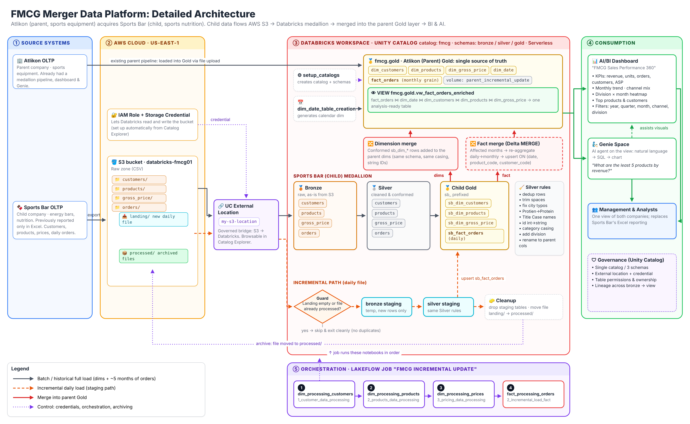</p>
<p align="center"><em>Figure 1: End-to-end architecture. Solid = batch, orange dashed = incremental, red = merge into parent, purple dotted = control/orchestration.</em></p>

<p align="center"><b>Simplified view</b></p>

<p align="center">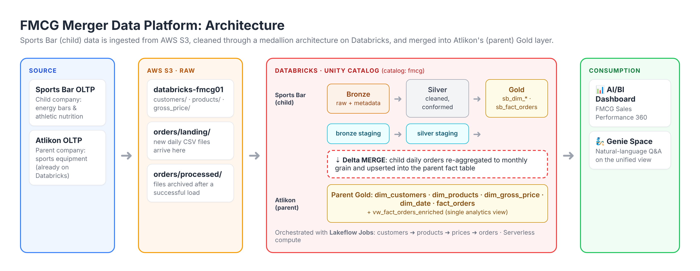</p>
<p align="center"><em>Figure 2: The same flow at a glance: Source → S3 → Databricks medallion → Parent Gold → Dashboard &amp; Genie.</em></p>

<details>
<summary>📝 Original design notes (hand-drawn while planning, click to expand)</summary>
<br>
<p align="center">
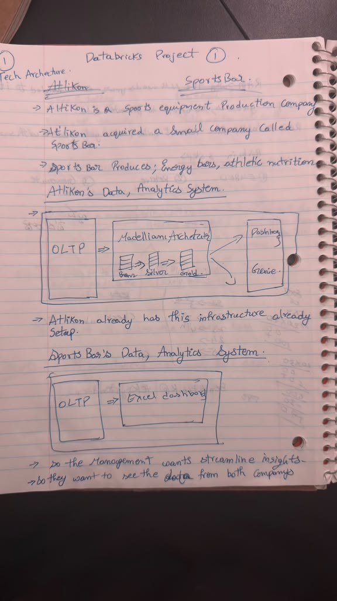
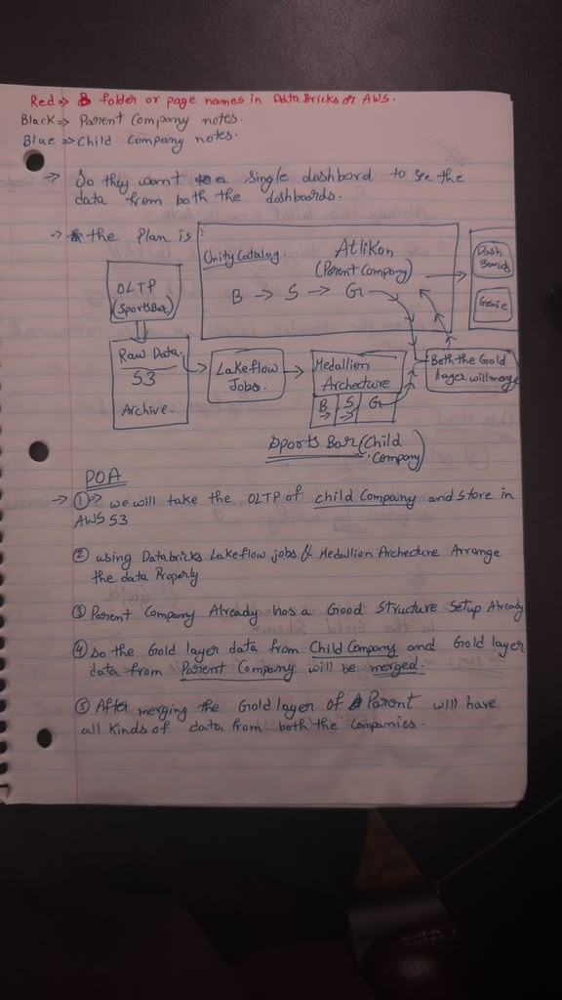
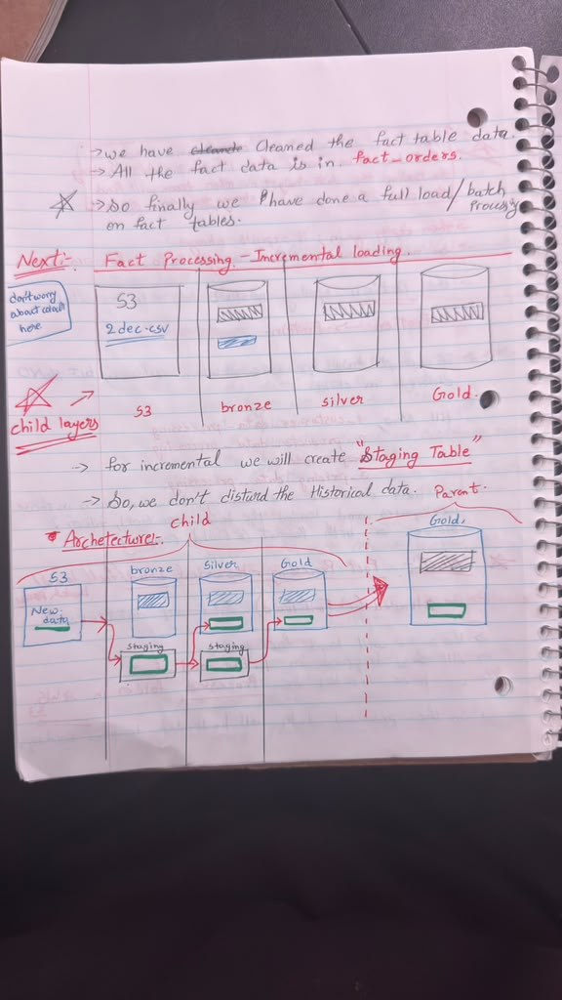
</p>
<p align="center"><em>Left: the business problem (Atlikon's mature platform vs Sports Bar's Excel reporting). Middle: the plan of action (child OLTP → S3 → Lakeflow → medallion → merge into parent Gold). Right: the incremental-load design with staging tables at each layer.</em></p>
</details>

**Plan of action**

1. Export Sports Bar's OLTP data to **AWS S3** (raw zone).
2. Connect S3 to Databricks through a **Unity Catalog external location**.
3. Process the child data through **Bronze → Silver → Gold** using PySpark notebooks.
4. **Merge** the child Gold data into the parent Gold tables.
5. Run a **historical backfill** (batch) first, then switch to **daily incremental loads**.
6. Orchestrate everything with **Lakeflow Jobs**.
7. Expose the unified data through a **SQL view**, a **Genie space**, and an **AI/BI dashboard**.

---

## 🧰 Tech Stack

| Layer | Technology |
|---|---|
| Storage (raw) | AWS S3 |
| Compute & processing | Databricks (Serverless), PySpark, Spark SQL |
| Table format | Delta Lake (MERGE, Change Data Feed) |
| Governance | Unity Catalog (catalog, schemas, external location, volume) |
| Orchestration | Databricks Lakeflow Jobs |
| BI & AI | Databricks AI/BI Dashboards, Genie |

---

## 🗂 Data Model

All tables live in the Unity Catalog catalog **`fmcg`** with three schemas: `bronze`, `silver`, `gold`.

**Gold layer: star schema**

| Table | Type | Description |
|---|---|---|
| `dim_customers` | Dimension | Customer, market, platform, channel |
| `dim_products` | Dimension | Product, category, division, variant |
| `dim_gross_price` | Dimension | Product price by period |
| `dim_date` | Dimension | Calendar attributes (year, quarter, month, year_quarter) |
| `fact_orders` | Fact | Sold quantity by date × product × customer (monthly grain) |
| `sb_dim_*` / `sb_fact_orders` | Child Gold | Cleaned Sports Bar tables before the merge |
| `vw_fact_orders_enriched` | View | Fact table joined with every dimension, used for BI and Genie |

<p align="center">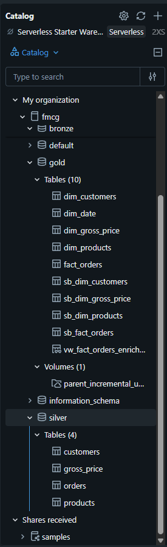</p>
<p align="center"><em>Figure 3: The <code>fmcg</code> catalog in Unity Catalog: <b>bronze</b> and <b>silver</b> hold the 4 child tables; <b>gold</b> holds the parent tables, the <code>sb_</code> child tables, and the enriched view.</em></p>

**S3 raw zone** (`databricks-fmcg01`)

<p align="center">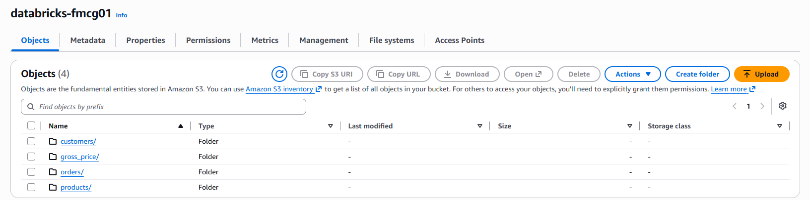</p>
<p align="center"><em>Figure 4: The raw S3 bucket, with one folder per source entity exported from the Sports Bar OLTP system.</em></p>

```
databricks-fmcg01/
├── customers/
├── products/
├── gross_price/
└── orders/
    ├── landing/      ← new daily files arrive here
    └── processed/    ← files are moved here after a successful load
```

---

## 📁 Project Structure

```
Consolidated_pipeline/
├── 1_setup/
│   ├── setup_catalogs              # creates catalog fmcg + bronze/silver/gold schemas
│   ├── utilities                   # shared helper functions
│   └── dim_date_table_creation     # generates the dim_date calendar table
├── 2_dimention_data_processing/
│   ├── 1_customer_data_processing
│   ├── 2_products_data_processing
│   └── 3_pricing_data_processing
└── 3_fact_data_processing/
    ├── 1_full_load_fact            # historical backfill (batch)
    └── 2_incremental_load_fact     # daily incremental + merge into parent
```

---

## 🔄 Pipeline Walkthrough

### 1. Setup
- Created the **`fmcg` catalog** and the `bronze`, `silver`, `gold` schemas.
- Loaded the parent company's (Atlikon) Gold tables.
- Generated the `dim_date` table with code.
- Connected S3 to Databricks: **Catalog Explorer → Create external location** (`my-s3-location`) → S3 bucket URL.

### 2. Dimension processing (child → parent)
Each dimension goes **Bronze (raw) → Silver (cleaned) → Gold (conformed)**, then gets merged into the parent dimension.

| Notebook | Key cleaning & transformations |
|---|---|
| **Customers** | Removed duplicates · trimmed extra spaces in `customer_name` · fixed city-name typos · title-cased names · cast `customer_id` from **int → string** · renamed columns to match the parent `dim_customers` |
| **Products** | Fixed the spelling error **`Protien → Protein`** · standardised `category` casing (child used lowercase, parent used title case) · derived a `division` column that exists in the parent but not in the child |
| **Pricing** | Cleaned and aligned prices to the parent `dim_gross_price` schema |

### 3. Fact processing: historical full load (batch)
- The child company already had **~5 months of order history**, loaded as a **historical backfill** with batch processing (`1_full_load_fact`).
- Daily CSV files were processed through Bronze → Silver → `sb_fact_orders`, and then moved to the `processed/` folder.

<p align="center">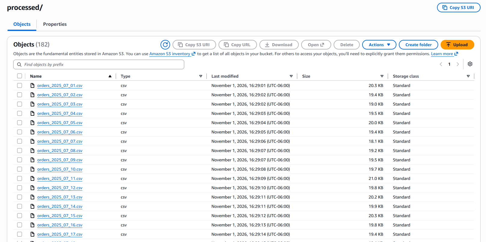</p>
<p align="center"><em>Figure 5: <code>orders/processed/</code> after the backfill: <b>182 daily order files</b> (<code>orders_YYYY_MM_DD.csv</code>), each moved here automatically after a successful load.</em></p>

### 4. Fact processing: incremental load
After the backfill, new daily files are processed incrementally using **staging tables**, so historical data is never disturbed.

<p align="center">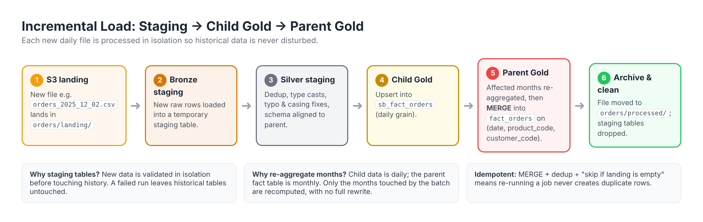</p>
<p align="center"><em>Figure 6: Life of one new daily file, from landing in S3 (step 1) through staging (2–3), child Gold (4) and the merge into parent Gold (5), to archive and cleanup (6).</em></p>

**How the child → parent merge works** (`2_incremental_load_fact`, "Merging with Parent company" section):

```python
# 1. Find the months touched by the incoming batch
incremental_months = (silver_staging_df
    .select(F.trunc("date", "MM").alias("month_start"))
    .distinct())

# 2. Pull all daily child rows for only those months
monthly_df = (spark.table("fmcg.gold.sb_fact_orders")
    .withColumn("month_start", F.trunc("date", "MM"))
    .join(incremental_months, "month_start")
    # 3. Re-aggregate daily → monthly (the parent's grain)
    .groupBy("month_start", "product_code", "customer_code")
    .agg(F.sum("sold_quantity").alias("sold_quantity"))
    .withColumnRenamed("month_start", "date"))

# 4. Upsert into the parent fact table
(DeltaTable.forName(spark, "fmcg.gold.fact_orders").alias("t")
    .merge(monthly_df.alias("s"),
           "t.date = s.date AND t.product_code = s.product_code AND t.customer_code = s.customer_code")
    .whenMatchedUpdateAll()
    .whenNotMatchedInsertAll()
    .execute())

# 5. Clean up: drop the bronze & silver staging tables
```

> **Why this design?** Child data is **daily** and the parent fact table is **monthly**. Only the affected months are recomputed and upserted, with no full table rewrite. Because the load is a MERGE, the pipeline is **idempotent**: re-running it never creates duplicate rows.

---

## ⚙ Orchestration

The whole pipeline runs as a single **Lakeflow Job**, *FMCG Incremental Update*, with 4 dependent tasks. Each task has its own **notebook path**, **dependency**, and **parameters**.

<p align="center">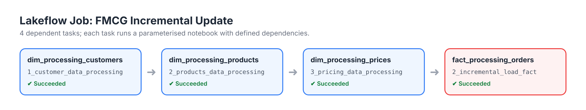</p>
<p align="center"><em>Figure 7: The Lakeflow Job runs dimensions first (customers → products → prices) so every fact row finds matching dimension keys, and then the fact load.</em></p>

---

## 📊 Analytics Layer

### Unified view
A single view, **`fmcg.gold.vw_fact_orders_enriched`**, joins `fact_orders` with the date, customer, product, and price dimensions. It gives analysts and BI tools one table to query.

<p align="center">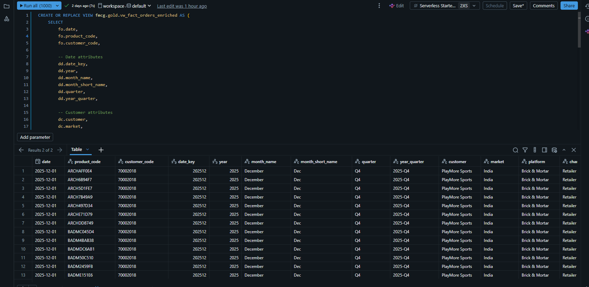</p>
<p align="center"><em>Figure 8: <code>CREATE OR REPLACE VIEW</code> in the SQL Editor. The result shows each order enriched with date, customer, market, platform and channel attributes.</em></p>

### Genie: natural-language analytics
A **Genie space** is connected to the view, so business users can ask questions in plain English, for example *"What are the least 5 products by revenue?"*

<p align="center">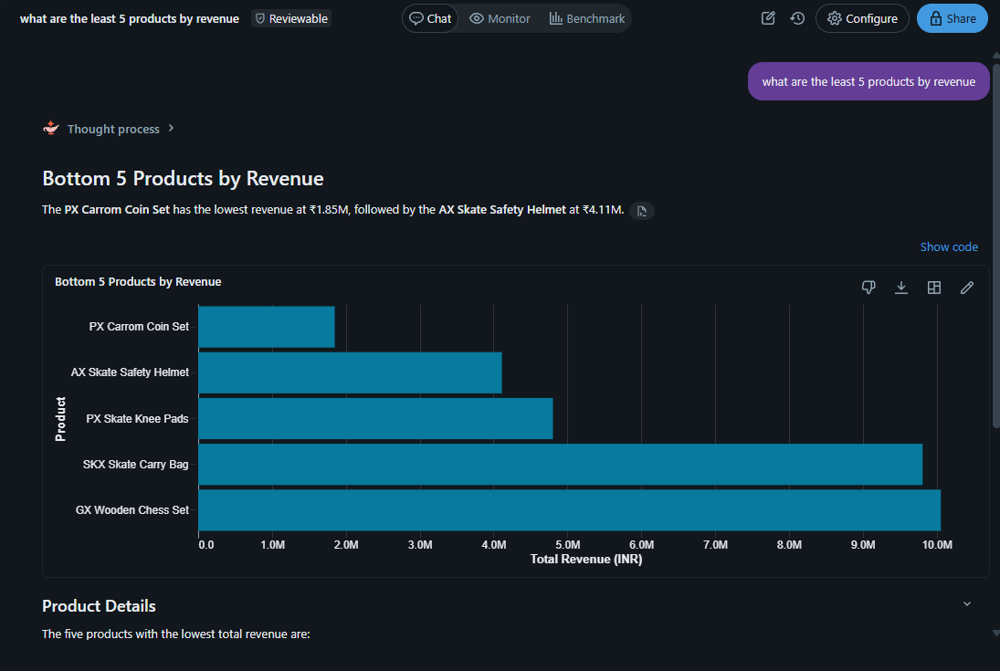</p>
<p align="center"><em>Figure 9: Genie answering a plain-English question. It writes the SQL, runs it on the view, and returns a chart plus a summary.</em></p>

### Dashboard: FMCG Sales Performance 360
Built with Databricks AI/BI Dashboards, using hand-written queries plus Genie-assisted visuals.

- **Filters:** Year · Quarter · Month · Channel · Division
- **KPIs (2025):** Total Revenue **₹84.9B** · Units Sold **30.5M** · Orders **58.4K** · Active Customers **54** · Avg Selling Price **₹4,075** · Products Sold **393**

<p align="center">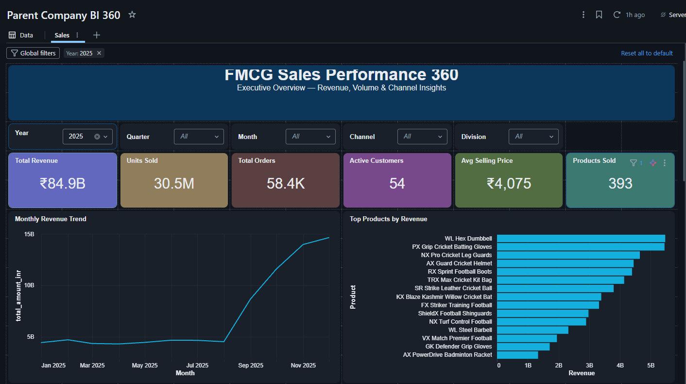</p>
<p align="center"><em>Figure 10: Executive overview, with filters at the top, 6 KPI tiles, the monthly revenue trend, and top products by revenue.</em></p>

The **Acquisition** channel and the Sports Bar divisions (*Breakfast Foods, Dairy & Recovery, Healthy Snacks*) appear from **July 2025** onward. This confirms the child company's data merged into the parent successfully.

<p align="center">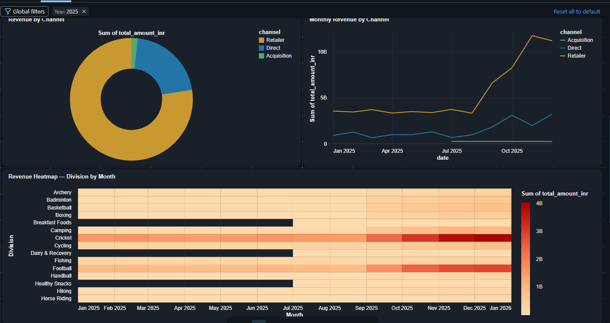</p>
<p align="center"><em>Figure 11: Revenue by channel (donut chart and monthly lines) and a division × month heatmap. The dark rows before Jul 2025 are Sports Bar divisions that had no data before the acquisition.</em></p>

<p align="center">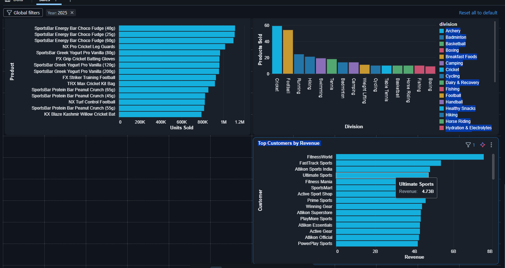</p>
<p align="center"><em>Figure 12: Top products by units sold (SportsBar energy bars rank alongside Atlikon cricket gear), products sold per division, and top customers by revenue.</em></p>

---

## 🧩 Challenges & Solutions

| # | Challenge | Solution |
|---|---|---|
| 1 | **Schema mismatch:** the child had different column names, an `int` customer_id, and no `division` column | Renamed and cast columns in Silver, and derived `division` to match the parent schema |
| 2 | **Data quality:** duplicates, extra spaces, city typos, `Protien` misspelling, inconsistent category casing | Built dedup, trim, standardisation, and title-case logic in the Silver layer |
| 3 | **Grain mismatch:** child orders are daily, parent fact is monthly | Re-aggregated only the affected months before the MERGE |
| 4 | **Protecting historical data** during incremental loads | Introduced Bronze/Silver **staging tables**, dropped after each run |
| 5 | **Job failure on re-run:** the Dec 31 file had already been processed, and re-uploading it created **duplicate values** | Added deduplication logic, plus a guard that **skips processing when landing is empty or the file is a duplicate**. After a retry, the pipeline succeeded |

---

## 💡 Key Learnings
- You can't catch every data issue on the first pass. After deployment, analysts find new issues, and the pipeline is updated and redeployed. **Gather enough requirements before building.**
- **Staging + MERGE** makes incremental pipelines safe to re-run.
- Conform the child data to the **parent's** model, not the other way around, so existing reports keep working.
- **Unity Catalog** external locations make S3 access governed and simple.
- A clean, enriched **Gold view** makes both Genie and dashboards much more accurate.

---

## ▶ How to Run
1. Create an S3 bucket with `customers/`, `products/`, `gross_price/`, and `orders/landing/` + `orders/processed/` folders, and upload the source CSVs.
2. In Databricks: **Catalog Explorer → External Locations → Create**, and point it at the bucket.
3. Run `1_setup/setup_catalogs`, then `1_setup/dim_date_table_creation`.
4. Run the dimension notebooks in order (customers → products → pricing).
5. Run `3_fact_data_processing/1_full_load_fact` for the historical backfill.
6. Create a Lakeflow Job with the 4 tasks shown above for daily incremental loads.
7. Create `vw_fact_orders_enriched`, then build the Genie space and dashboard on top of it.

---

## 👤 Author
**Vykunta Kishore**, Data Engineer
🔗 [LinkedIn](#) · [GitHub](#)

⭐ If you found this project useful, consider giving it a star!
